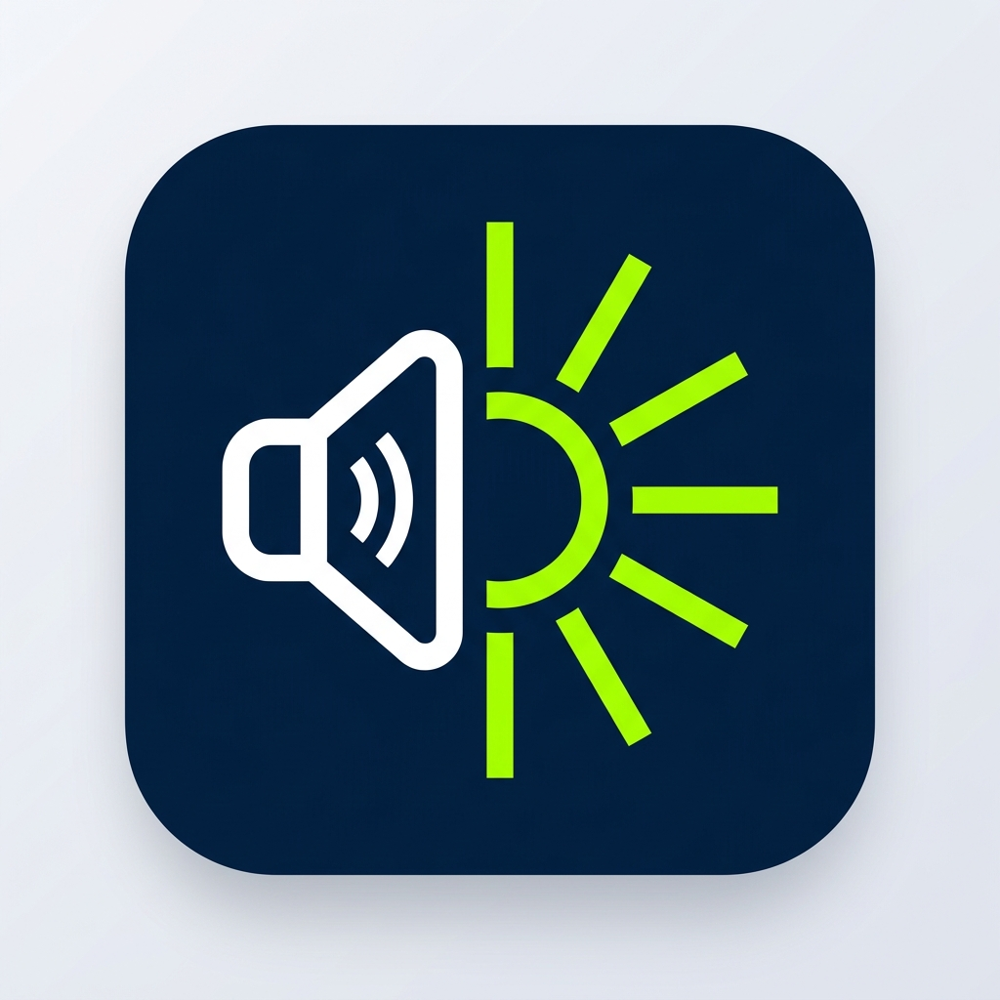
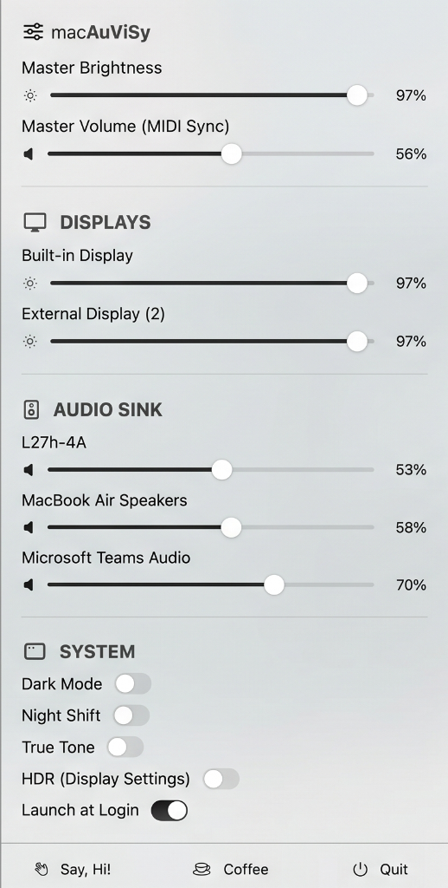

<div align="center">
  
  <h1>macAuViSy</h1>
  <p><strong>A beautifully unified macOS Menu Bar utility for Master Display & Audio Control.</strong></p>
  
  [](https://apple.com/macos)
  [](https://swift.org)
  [](LICENSE)
</div>

<hr/>

## 🎯 Overview

**macAuViSy** is a lightweight, natively-built macOS menu bar utility designed to give you complete command over your multi-monitor desktop workspace. Whether you are managing multiple external displays over USB-C, DisplayPort, or HDMI, or routing audio through external monitors, DACs, and speakers, **macAuViSy** consolidates hardware controls into an elegant, reactive interface.

Say goodbye to reaching behind monitors for physical OSD buttons or digging through System Settings. Control master brightness, synchronize audio sinks via MIDI volume synchronization, toggle system appearance and color profiles, and use your native Mac keyboard media keys—all with zero intrusive prompts and zero background overhead.

---

## ✨ Features

### 🖥️ Multi-Screen Liquid Glass OSD Overlay
- **Multi-Screen Centering**: Renders floating, liquid-glass HUDs in the exact center of every connected monitor simultaneously.
- **16 Discrete Apple Chiclets**: 6.25% stepping resolution matching native macOS Monterey/Ventura/Sonoma/Sequoia volume & brightness graduations.
- **Adaptive Appearance & Zero-Cutoff Rendering**: Dynamic specular glass rim lighting with native Dark Mode & Light Mode support and zero rectangular window clipping.
- **Vibrant Alert Mute Badge**: Red pill capsule badge displaying a crisp speaker slash icon and bold "MUTED" typography.

### 🎛️ Unified & Granular Controls
- **Master Brightness & Volume Sliders**: Control the brightness and volume of all connected monitors and audio sinks simultaneously with one drag.
- **Per-Device Precision Sliders**: Independent sliders for individual external displays and sound outputs.
- **Real-Time Reactive Bindings**: Bidirectional SwiftUI slider synchronization with zero lag.
- **Proportional Offset Preservation**: Media keys preserve individual per-monitor and per-audio device volume/brightness offsets without flattening custom multi-device balance.

### 🖥️ Hardware DDC & DRM-Safe Dimming
- **Coalesced DDC/CI Hardware Worker**: Adjust external display backlight levels via I2C with a 40ms cancellation debounce, preventing I2C bus flooding or monitor microcontroller freezes.
- **100% FairPlay & HDCP DRM-Safe Gamma Scaling**: Uses native GPU color transfer table scaling (`CGSetDisplayTransferByTable`) rather than transparent overlay windows. Watch DRM-protected streams (Netflix, Apple TV+, Prime Video, Disney+) without video blackouts or HDCP handshake errors.
- **True Zero Dimming**: Smoothly scale external displays down to complete darkness (0%) without backlight bleed.
- **Hotplug & Wake-from-Sleep Resilience**: 0.8s settling debounce prevents directly connected USB-C and HDMI displays from dropping to 0% brightness upon connect or wake.

### 🔊 Dynamic Audio Sink Synchronization
- **CoreAudio Transport Classification**: Automatically detects and synchronizes DisplayPort (`'dprt'`) and HDMI (`'hdmi'`) audio sinks.
- **Zero Hardcoding**: Eliminates vendor or model string heuristics in favor of declarative CoreAudio device topology.

### ⌨️ Global Media Key Interception & Silent Startup
- **Media Key Support**: Intercepts Mac keyboard brightness (F1/F2) and volume (F11/F12) keys to adjust external hardware.
- **Zero Startup Popups**: Completely eliminates intrusive macOS permission dialogs on system reboot.
- **Passive Background Permission Monitor**: Automatically detects Accessibility authorization when enabled in System Settings without requiring an app relaunch.
- **On-Demand User Affordance**: In-app status banner allows user-initiated permission requests on demand.

### 🌓 Quick System Toggles
- **Dark Mode**: Instantly switch between Light and Dark system appearance.
- **Night Shift**: Toggle Night Shift with user preference persistence (no unwanted yellow tint on boot).
- **True Tone**: Native toggle for supported displays.
- **HDR Shortcut**: One-click jump to Displays settings.
- **Launch at Login**: Seamless auto-start via modern `SMAppService`.

---

## 📸 Screenshots

<div align="center">
  
</div>

---

## ⚠️ Known Issues

- **External Display Mute Synchronization**: Audio mute/unmute may intermittently fail on certain external DDC/CI-connected displays due to hardware I2C bus race conditions and display microcontroller response times. A further enhancement is planned for the upcoming release.

---

## 🛠️ Installation

### Option 1: Direct Download (Recommended)
1. Download `macAuViSy.zip` from the latest [GitHub Release](https://github.com/DataScienceOven/macAuViSy/releases/latest).
2. Unzip and copy `macAuViSy.app` to your `/Applications` directory.
3. Launch `macAuViSy` from Spotlight or Launchpad.

### Option 2: Build from Source
To compile and install locally:
```bash
git clone https://github.com/DataScienceOven/macAuViSy.git
cd macAuViSy
./build_install.sh
```
The script compiles the project with Swift Package Manager, builds the signed `.app` bundle with custom high-resolution icons, and installs it cleanly into `/Applications/macAuViSy.app`.

---

## 💻 Tech Stack

- **Swift 5.9+ & SwiftUI**: Native Apple Silicon performance and low memory footprint.
- **CoreAudio & AudioToolbox**: Device enumeration, transport detection, and volume sync.
- **CoreGraphics & DisplayServices**: DDC/CI communication and GPU color transfer tables.
- **ServiceManagement**: Modern macOS login item registration (`SMAppService`).

---

## ☕ Support the Developer

If macAuViSy has improved your desktop setup, consider saying hi or buying a coffee!

<a href="https://buymeacoffee.com/abhi.cser"></a>
<a href="https://abhi-cser.github.io/"></a>

---

## 📄 License

This project is licensed under the GNU General Public License v3.0 - see the [LICENSE](LICENSE) file for details.
